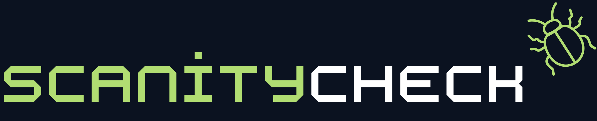

# ScanityCheck

*Everyone Needs a ScanityCheck... Because Ignoring Vulnerabilities is a Special Kind of Insanity.* — a small desktop app that takes a GitHub
repository URL, runs **fourteen** open-source scanners against it locally, and
returns one weighted 0–100 security score with the verdict, a severity pie
chart, a confidence gauge, compliance-framework mapping, the biggest risks, and
an explanation of how the number was built.

Every finding names **which scanner found it** and **where it lives** (file and
line), and the same issue reported by several tools is charged once while still
listing all of them.

Everything runs on your machine. No source code is uploaded anywhere except the
GitHub download of the repository itself.



---

## Quick start

1. Double-click **`Run ScanityCheck.bat`** (or run `python app.py`).
2. Paste a URL such as `https://github.com/pallets/flask`.
3. Tick the scanners you want (all are ticked by default) and, optionally, the
   compliance frameworks to map findings onto.
4. Press **Scan repository** (any other web address starts a website scan - see
   [Website scans](#website-scans) below).

The first scan downloads the scanner engines into
`~/.repo-security-scorer/tools/` (several hundred MB, plus Grype's vulnerability
database which can be several GB). CodeQL, Trivy, Grype, OSV-Scanner, GitLeaks,
TruffleHog, Syft, Nuclei and Kubescape are bundled executables; Semgrep CE,
Checkov and GuardDog are installed into their own private virtual environments.
OpenSSF Scorecard and OSS-Fuzz need no binary at all — they ask public HTTP
records. The download can
take a few minutes on the first run; after that, scans start immediately.

Dependencies: Python 3.10+ and an internet connection. No `pip install`, no
Docker, no Git required.

---

## What happens during a scan

| Step | Detail |
| --- | --- |
| 1. Fetch | Source zip from `codeload.github.com` (so Git is not needed), default branch auto-detected |
| 2. Detect | Languages inferred from file extensions, skipping `node_modules`, `vendor`, build output, etc. |
| 3. Inventory | Syft builds an SBOM of everything the repo could ship (context only, never scored) |
| 4. Dependencies | Trivy, Grype (fed Syft's SBOM) and OSV-Scanner read lockfiles/manifests and report known CVEs |
| 5. Secrets | Trivy, GitLeaks, TruffleHog and Checkov look for committed credentials (values are redacted) |
| 6. Config | Trivy and Checkov check Dockerfiles/IaC for risky configuration |
| 7. Active web | Nuclei runs DAST templates against the repo's homepage and/or GitHub Pages candidate (skipped when there is none) |
| 8. Platform IaC | Kubescape scans Kubernetes/manifest files against the NSA and MITRE control frameworks |
| 9. Posture | OpenSSF Scorecard reports failing posture checks from the public scorecard.dev API (skipped when no result is published) |
| 10. Fuzzing | OSS-Fuzz coverage is read from the public google/oss-fuzz project registry (no open bugs are queried) |
| 11. Code | CodeQL data-flow queries and Semgrep CE pattern rules analyse source files |
| 12. Supply chain | GuardDog's malware rules hunt malicious-package and install-script patterns |
| 13. Merge | Duplicate findings across tools are collapsed into one issue with a tool list |
| 14. Score & map | Weighted penalties per finding, capped per category, plus framework mapping and confidence |
| 15. Care & feeding | Maintenance statistics from the GitHub API: commit/release cadence, trend, PR/issue response times, contributor activity, recency |

Compiled languages (Java/Kotlin, C#, C/C++, Go, Swift) use CodeQL's
`--build-mode=none`, so no compiler or build system has to be installed.

### The scanners

| Scanner | Finds | Notes |
| --- | --- | --- |
| **CodeQL** | data-flow security bugs | required; top two detected languages; `security-extended` suite |
| **Trivy** | dependency CVEs, secrets, IaC/container misconfig | required; built-in vulnerability database |
| **Semgrep CE** | pattern-based code security | community `p/default` ruleset; needs registry access |
| **Grype** | dependency CVEs | second vulnerability database (Anchore); scans Syft's SBOM when available |
| **OSV-Scanner** | dependency CVEs | third database (OSV/GHSA) |
| **GitLeaks** | committed secrets | values redacted in the report |
| **TruffleHog** | committed secrets | verification disabled, so no secret is sent to a third party |
| **Syft** | SBOM inventory | adds context, never removes points; output also feeds Grype |
| **Checkov** | IaC and container misconfigurations (and secret checks) | pinned 3.4.0 in a private venv |
| **GuardDog** | malicious-package and supply-chain patterns | pinned 2.2.0 on Windows (3.x needs a Rust toolchain there) |
| **Nuclei** | active DAST template findings on live web endpoints | runs against the package.json homepage and/or the GitHub Pages candidate; skipped when neither exists |
| **Kubescape** | Kubernetes/IaC misconfigurations | downloads control definitions on first run; non-zero exit means the compliance score is below 100 |
| **OpenSSF Scorecard** | repository security posture via the public scorecard.dev API | pure REST, no binary; skipped when no published result exists |
| **OSS-Fuzz** | continuous-fuzzing coverage signal | registry lookup only — the issues dashboard has no public API, so open bugs are not queried |

The three dependency scanners overlap on purpose: cross-tool de-duplication keeps
the same CVE from being charged more than once while recording every tool that
found it. The same applies to secrets and code findings.

---

## The scoring model

```
score = 100 − Σ (capped penalty for each category)
```

| Category | Critical | High | Medium | Low | Cap |
| --- | --- | --- | --- | --- | --- |
| Dependency vulnerability | 12 | 6 | 1.5 | 0.3 | 45 |
| Committed secret | 15 | 10 | 5 | 1 | 25 |
| IaC / container misconfig | 8 | 4 | 1 | 0.2 | 10 |
| Code security finding | 10 | 5 | 1.5 | 0.4 | 40 |
| Code maintainability (non-security) | 0.2 flat | | | | 6 |

Severity sources vary by tool: Trivy and Grype provide their own rating; OSV uses
`database_specific.severity` (falling back to medium); Semgrep maps
ERROR/WARNING/INFO to high/medium/low; GitLeaks treats private keys as critical
and other credentials as high; TruffleHog treats verified credentials as
critical, unverified private keys as high and other unverified credentials as
medium; GuardDog rules are critical/high by rule class; Checkov findings without
a tool-supplied severity are recorded as *unknown* and rated accordingly.
Nuclei follows its template's severity rating (with `info` filed as *unknown*)
and only counts as a vulnerability finding when the template carries a CVE;
Kubescape's Critical/Important/Medium/Low/Info scale is mapped straight onto
critical/high/medium/low/unknown; a Scorecard check rated 0 counts as medium and
any other failing check (1–6) as low; OSS-Fuzz produces at most one
informational code finding when a project is not continuously fuzzed.

**Risk bands (score scale):**
90-100 Very Low (green) - 80-89 Low (light green) - 70-79 Moderate (light
yellow) - 60-69 Elevated (yellow) - 40-59 High (orange) - 20-39 Very High
(red) - 0-19 Critical (dark red).

**Verdict:** a repository is reported **SECURE** only when the score is ≥ 85,
there are zero critical findings, and the required scanners (CodeQL and Trivy)
completed. A failure of an optional scanner is shown as a warning instead. If a
required scanner fails, the run is **INSECURE** — an incomplete scan is never
treated as a clean bill of health.

### De-duplication and attribution
- **Dependency findings** merge on canonical CVE + package. Grype often reports a
  GHSA id, so the matching CVE is recovered from its aliases, EPSS/CWE blocks and
  reference URLs before merging.
- **Secret findings** merge on file + line + credential family, so the same AWS
  key found by GitLeaks, Trivy, TruffleHog and Checkov costs points once and
  names all four tools.
- **Code findings** merge on file + line + CWE, so CodeQL and Semgrep reporting
  the same injection count once.
- A merged finding keeps the worst severity and the largest single penalty, and
  records every detecting tool in `tools` / `tool_labels`.
- The report shows the de-duplication arithmetic in plain numbers: raw findings
  per tool → unique issues → duplicates removed → issues corroborated by 2+ tools.

---

## The dashboard

- **Frameworks row** — tick **NIST RMF, NIST CSF, HIPAA, GDPR, CMMC,
  ISO 27001, ISO 42001, PCI DSS or SOC 2 Type 2** and the findings are mapped onto the
  affected controls of each framework (e.g. `Req 8.x`, `A.8.12`, `CC6.1`).
  Mapping is keyword-based, transparent, and **never changes the score**. A
  control with no matching findings is shown as *clear* in that run — evidence
  of a clean check, not proof of compliance. Ticked frameworks are remembered.
- **Severity pie chart** — a donut next to the score splits the findings by
  critical/high/medium/low/unknown, with counts and a legend, so a scan's
  severity mix is readable at a glance.
- **Care and Feeding** — a maintenance profile served straight from the GitHub
  API: last commit, last release and release cadence, commit frequency, the
  development trend (accelerating / steady / slowing / dormant), open pull
  requests and the oldest one, the oldest open issue, median issue/PR
  resolution times, contributor activity, and the commit recency distribution
  (1/7/30/90-day share of the last year's commits). Included in the popup, the
  text/CLI report and the PDF; it never changes the score.
- **Confidence gauge** — a 0–100 meter states how much *this report itself* can
  be trusted. It is built from four weighted signals: whether the selected
  scanners completed (required tools count double), how many findings were
  corroborated by another tool, how many severities were actually rated rather
  than *unknown*, and how many tools contributed. Plain notes explain what
  dragged the figure down. Confidence describes the *report*, not the repo.
- **Score card** — the number, its band, the SECURE/INSECURE verdict, the
  reason, and critical/high/medium/low counts.
- **Report tab** — what the score means, where the points went, de-duplication
  numbers, the SBOM inventory, the greatest risks (each with *Identified by:*,
  file/line and references, plus an **omit** checkbox: ticking a risk row
  excludes it from the score because it is mitigated elsewhere, and the score,
  verdict and charts re-adjust immediately. Excluded risk rows refund their
  stated points straight from their category's applied penalty - even where a
  category cap would otherwise absorb the change, and never below zero.), severity totals, a **Findings by
  tool** table, the compliance mapping, an **All findings** list (up to 300),
  warnings, and scanner coverage.
- **Activity log tab** — live scanner output, useful when something goes wrong.
- **Footer** — copy the text report, save a JSON report, **export findings to
  CSV** (Excel-friendly, one row per unique finding), **print the whole report
  to PDF** (paginated A4 with score box, pie data, tables and mapping), and
  open the folder with the raw scanner output.

Artifacts are kept under `~/.repo-security-scorer/`:

```
tools/     downloaded scanner binaries, private scanner venvs, and databases
work/      per-scan source checkout and raw scanner output (auto-pruned after 48h)
reports/   a JSON copy of every scan
```

---

## Website scans

Point the URL box at any live web address and the app runs a website scan
instead of a source scan:

- **Built-in web audit** (always on for a site) - fetches the page, rates the
  hardening headers (Content-Security-Policy, HSTS, X-Content-Type-Options,
  X-Frame-Options, Referrer-Policy; missing ones are low misconfigurations),
  flags a plain-HTTP address as a high transport finding, and probes
  `/.env` and `/.git/config` for real return content (an SPA fall-back page is
  not treated as exposure); a working leak is a high secret finding.
- **Nuclei** runs its active DAST templates against the address when it is
  ticked (first run downloads the ~50 MB binary and the template pack).
- Every source-side scanner is recorded as *skipped - not applicable*, which
  is a neutral status, so the verdict comes from the web findings alone and a
  hardened site can finish SECURE. The report labels the run
  `scan_kind: website`; the dashboard's source-only widgets show their usual
  "not assessable here" placeholders.

Website scanning hits the address the user chose; only scan sites you are
allowed to test.

---

## Command line

```powershell
python cli.py https://github.com/owner/repo
python cli.py owner/repo --json report.json
python cli.py owner/repo --csv findings.csv --pdf report.pdf
python cli.py owner/repo --quiet          # scanner logs suppressed
python cli.py owner/repo --no-artifacts   # delete the checkout afterwards
python cli.py owner/repo --tools codeql,trivy,osv
python cli.py owner/repo --frameworks pci,iso
```

Exit codes: `0` secure, `1` insecure, `2` scan failed — handy in CI.

The same data is in the JSON report: `findings[]` carries `tool`, `tools`,
`tool_labels`, `file`, `line`, `location` and `locations`; `by_tool` summarises
how many findings each scanner produced; `dedupe` shows the merge arithmetic;
`confidence` carries the gauge; `frameworks` holds the full control mapping.

---

## Private repositories

Export a token before launching; it is used for the GitHub API and the zip
download:

```powershell
$env:GITHUB_TOKEN = "ghp_..."
python app.py
```

---

## Privacy

TruffleHog runs with `--no-verification`. Without that flag it would try to
validate every discovered credential against the vendor's API, which transmits
the secret to a third party. As a result, credentials are reported as
"unverified" and are scored as medium (or high for private keys) rather than
critical. Everything else stays local, apart from the GitHub source download
and Semgrep's ruleset download.

---

## Configuration

All weights, caps, bands, the 85-point pass mark, language mapping, scanner
list, framework map, brand colours and cache location live in **`config.py`**
and **`compliance.py`**. Environment overrides:

| Variable | Effect |
| --- | --- |
| `RSS_CACHE_DIR` | Move the tool/work/report cache elsewhere |
| `GITHUB_TOKEN` / `GH_TOKEN` | Authenticate against GitHub |

---

## What this tool does *not* tell you

- A high score is the absence of *known* findings, not proof of security.
- A clear compliance control means "no finding in this scan"; it is not certification.
- The confidence gauge describes the report, not the repository.
- Dependency scanning is best-effort: the scanners need a lockfile or manifest.
- Semgrep CE and its ruleset need network access; everything else is offline.

---

## Tests

```
python -m unittest discover -s tests
```

Covers approx. 60 unit tests: parser samples for all fourteen scanners, cross-tool
de-duplication, scoring caps and bands, framework keyword mapping, the
confidence model, CSV/PDF exports and the settings migration path.
